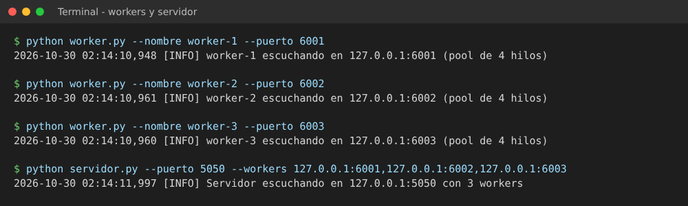
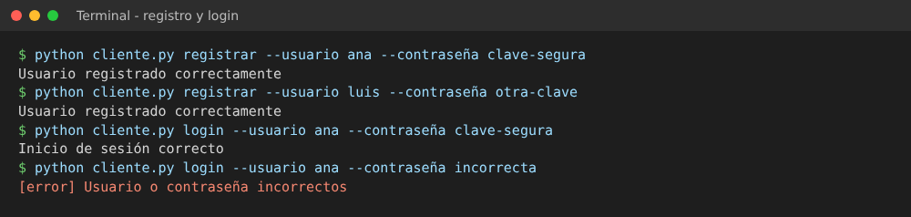
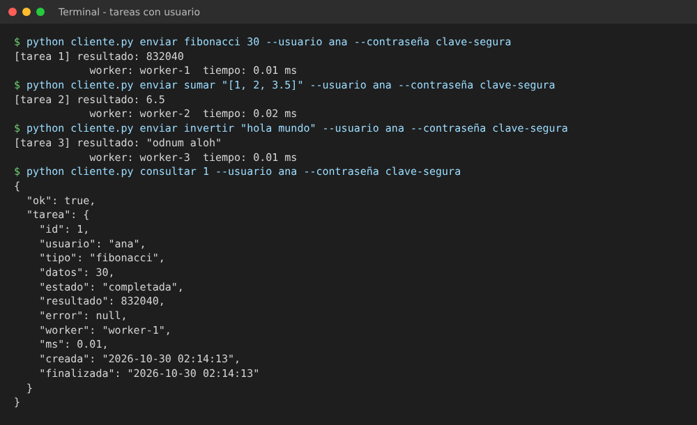
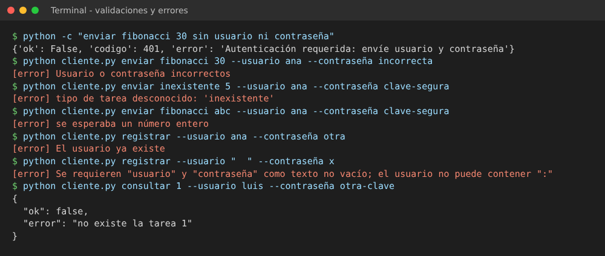
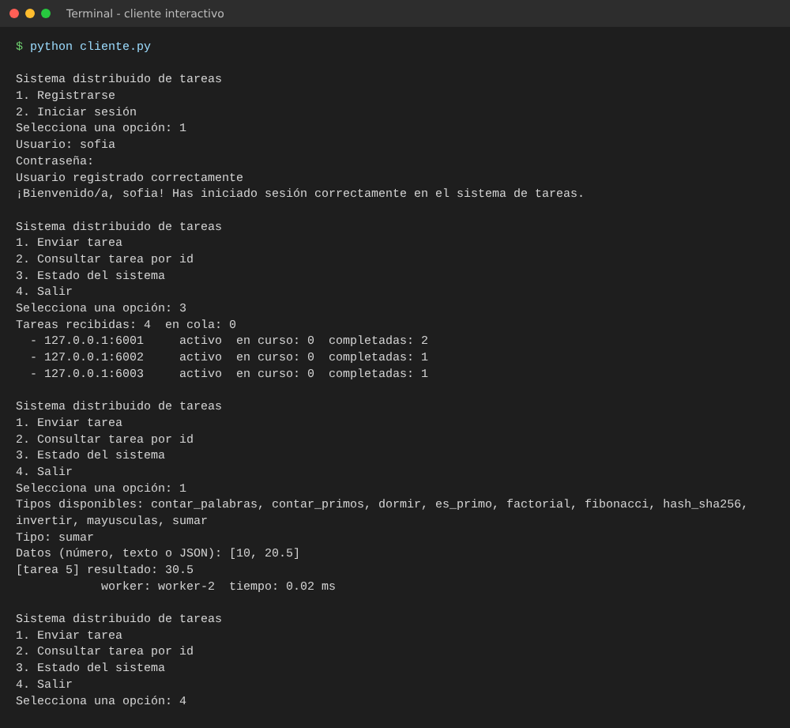
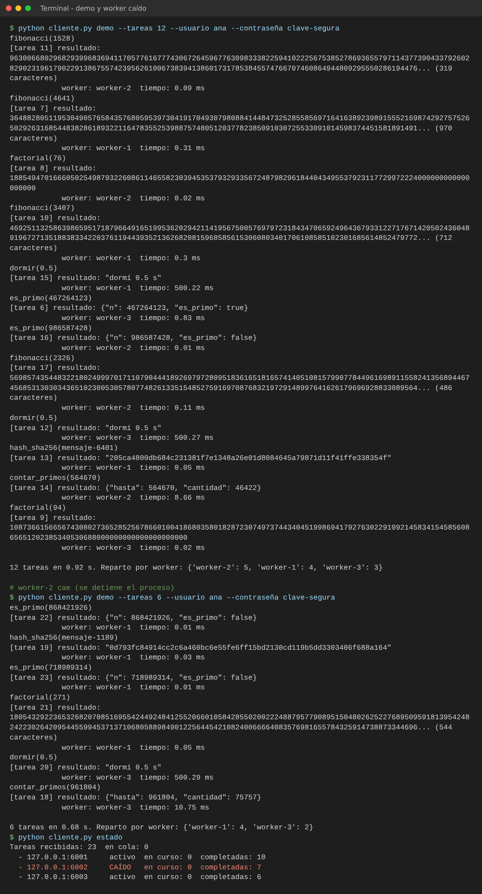
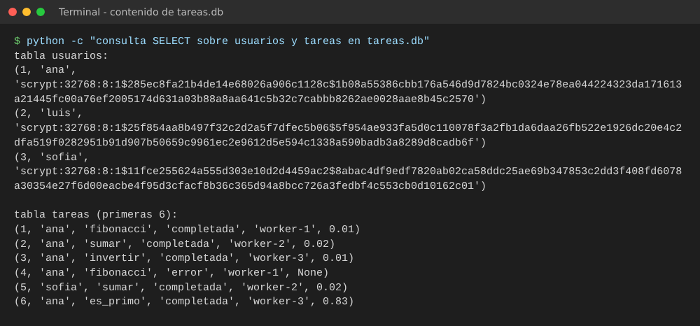
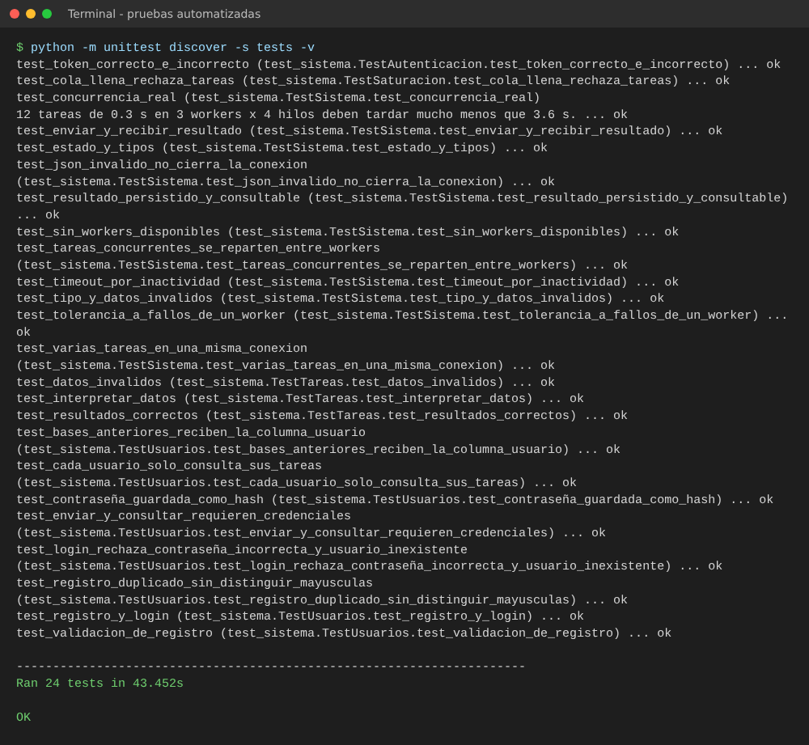

# PFO 3: Rediseño como Sistema Distribuido (Cliente-Servidor)

| | |
|---|---|
| **Alumno** | Gastón Zampar |
| **Materia** | Programación sobre Redes — 3° E |
| **Carrera** | Tecnicatura Superior en Desarrollo de Software |
| **Institución** | IFTS N° 29 |
| **Trabajo** | Práctica Formativa Obligatoria 3 (PFO 3) |

## Descripción

Rediseño de un sistema cliente-servidor como **sistema distribuido** basado en sockets TCP. Un servidor recibe tareas de varios clientes y las reparte entre un conjunto de **workers** independientes, cada uno con su propio **pool de hilos**. Si un worker cae, el servidor lo detecta y reintenta la tarea en otro, de modo que el cliente no nota la falla (transparencia de fallos).

Los usuarios se registran e inician sesión con contraseñas hasheadas, y cada usuario solo accede a sus propias tareas.

El trabajo tiene dos partes:

1. **Diseño**: diagrama de la arquitectura objetivo (clientes, balanceador, workers, cola de mensajes y almacenamiento distribuido).
2. **Implementación en Python** (solo biblioteca estándar): servidor, workers y cliente.

## 1. Diagrama del sistema


| Componente del diseño | Rol | En el código |
|---|---|---|
| **Clientes** (móvil, web, consola) | Generan tareas | `cliente.py` (sockets TCP + JSON) |
| **Balanceador de carga** (Nginx/HAProxy) | Reparte conexiones entre instancias del servidor, con health checks | No implementado: es infraestructura. El servidor es *stateless*, así que se puede replicar detrás de Nginx (`stream`) o HAProxy (modo `tcp`) |
| **Servidor / gateway** | Recibe tareas, las encola y las distribuye | `servidor.py` |
| **Workers con pool de hilos** | Ejecutan las tareas | `worker.py` (`ThreadPoolExecutor`) |
| **Cola de mensajes** (RabbitMQ) | Desacopla servidor y workers, absorbe picos | `queue.Queue` acotada dentro de `servidor.py` |
| **Almacenamiento** (PostgreSQL) | Persistencia de tareas/resultados y de archivos | SQLite (`tareas.db`) en lugar de PostgreSQL |

El diagrama muestra la arquitectura **objetivo** (producción). Lo marcado en azul está implementado en este repositorio; lo punteado es un componente de producción que el código simula o reemplaza por uno más simple.

## 2. Implementación

```text
PFO3/
├── servidor.py        # Servidor: recibe tareas por socket y las distribuye a workers
├── worker.py          # Worker: servidor TCP con pool de hilos que ejecuta tareas
├── cliente.py         # Cliente de consola (comandos, demo concurrente y menú)
├── tareas.py          # Catálogo de tareas que ejecutan los workers
├── protocolo.py       # Formato de mensajes compartido (JSON por línea sobre TCP)
├── usuarios.py        # Registro, inicio de sesión y hash de contraseñas (scrypt)
├── iniciar_todo.py    # Atajo: levanta workers + servidor en una terminal
├── requirements.txt   # Sin dependencias externas
├── tests/
│   └── test_sistema.py
├── capturas/          # Capturas de la ejecución y de las pruebas
└── docs/              # Diagrama (png, svg, mermaid)
```

### Flujo de una tarea

```text
cliente ──socket──▶ hilo de conexión ──▶ cola ──▶ despachador ──socket──▶ worker (pool de hilos)
   ▲                                                    │                        │
   └────────────────────── resultado ◀──────────────────┴──── resultado ◀───────┘
```

1. El cliente abre un socket TCP y envía un mensaje JSON con sus credenciales (`{"accion": "enviar", "usuario": "ana", "contraseña": "clave", "tipo": "fibonacci", "datos": 30}`).
2. Un hilo del pool del servidor verifica las credenciales, registra la tarea en la base (`pendiente`, asociada al usuario) y la pone en la cola.
3. Un despachador toma la tarea, elige el worker **con menos tareas en curso** (desempata por el menos recientemente usado) y se la envía por otro socket.
4. El worker la ejecuta en un hilo de su pool y devuelve el resultado.
5. El servidor guarda el resultado (`completada` o `error`) y responde al cliente.

### Protocolo

Un mensaje por línea, en JSON UTF-8, terminado en `\n` (TCP es un flujo de bytes y no delimita mensajes).

| Acción (cliente → servidor) | Campos | Respuesta |
|---|---|---|
| `registro` | `usuario`, `contraseña` | `{"ok": true, "codigo": 201}` o `{"ok": false, "codigo": 400 \| 409, "error"}` |
| `login` | `usuario`, `contraseña` | `{"ok": true, "codigo": 200, "usuario"}` o `{"ok": false, "codigo": 400 \| 401, "error"}` |
| `enviar` | `usuario`, `contraseña`, `tipo`, `datos`, `token` (si el servidor lo exige) | `{"ok": true, "id", "resultado", "worker", "ms"}` o `{"ok": false, "error"}`; sin credenciales válidas, `codigo: 401` |
| `consultar` | `usuario`, `contraseña`, `id` | datos de una tarea **propia**; una tarea de otro usuario responde "no existe" |
| `estado` | — | tareas en cola y estado de cada worker |
| `tipos` | — | tipos de tarea disponibles |

Tipos de tarea: `fibonacci`, `factorial`, `es_primo`, `contar_primos`, `invertir`, `mayusculas`, `contar_palabras`, `sumar`, `hash_sha256`, `dormir`.

### Decisiones técnicas

- **Sockets TCP** (`socket`) con mensajes JSON delimitados por salto de línea.
- **Pool de hilos** en el servidor (conexiones de clientes) y en cada worker (ejecución de tareas), con `ThreadPoolExecutor`: se evita crear un hilo por conexión sin límite.
- **Cola acotada**: si se llena, el servidor responde "servidor saturado" en lugar de agotar la memoria (contrapresión).
- **Balanceo por menor carga** con contador de tareas en curso protegido por `threading.Lock`.
- **Tolerancia a fallos**: ante un error de conexión con un worker se lo marca caído unos segundos y la tarea se reintenta en otro; si no quedan workers se informa el error al cliente.
- **Timeouts**: se cierran las conexiones de clientes inactivos y se limita el tiempo de espera a los workers.
- **Autenticación** opcional por token compartido (`--token` o `PFO3_TOKEN`), comparado con `hmac.compare_digest`.
- **Usuarios**: registro e inicio de sesión con una tabla `usuarios` en SQLite. Las contraseñas se guardan como hash scrypt con sal aleatoria (`hashlib.scrypt`, formato `scrypt:N:r:p$sal$hash`) y se comparan con `hmac.compare_digest`. Sigue sin depender de paquetes externos.
- **Tareas por usuario**: cada tarea queda asociada a su usuario, y `consultar` solo devuelve tareas propias.
- **Validación** de cada entrada (rangos y tipos) y límite de tamaño de mensaje.
- **Logging** de conexiones, tareas y fallos con el módulo `logging`.
- **Persistencia** con consultas parametrizadas; una tabla `tareas` con estado, resultado, worker y tiempos.
- **Hilos y GIL**: los hilos de un mismo worker comparten un intérprete, por lo que las tareas de CPU no corren en paralelo real dentro de un worker. El paralelismo real viene de tener **varios workers (procesos distintos)**; para tareas de E/S los hilos sí alcanzan.

## Requisitos

- Python 3.10 o superior.
- No hace falta instalar paquetes.

## Ejecución

Forma rápida (una terminal, levanta 3 workers y el servidor):

```bash
python iniciar_todo.py
```

Forma manual (una terminal por proceso):

```bash
python worker.py --nombre worker-1 --puerto 6001
python worker.py --nombre worker-2 --puerto 6002
python worker.py --nombre worker-3 --puerto 6003
python servidor.py --puerto 5050 --workers 127.0.0.1:6001,127.0.0.1:6002,127.0.0.1:6003
```

Cliente (en otra terminal):

```bash
python cliente.py                                                    # menú: registrarse o iniciar sesión
python cliente.py registrar --usuario ana --contraseña clave-segura
python cliente.py login --usuario ana --contraseña clave-segura
python cliente.py enviar fibonacci 30 --usuario ana --contraseña clave-segura
python cliente.py enviar sumar "[1, 2, 3.5]" --usuario ana --contraseña clave-segura
python cliente.py consultar 1 --usuario ana --contraseña clave-segura
python cliente.py estado
python cliente.py demo --tareas 12 --usuario ana --contraseña clave-segura   # 12 tareas desde clientes concurrentes
```

Si se omiten `--usuario` o `--contraseña`, el cliente los pide por consola (la contraseña no se muestra al escribirla). Las salidas reales de cada escenario están en la sección [Capturas de pantalla](#capturas-de-pantalla).

## Pruebas automatizadas

```bash
python -m unittest discover -s tests -v
```

Levantan workers y servidor reales en puertos libres de `localhost` y comprueban: resultados correctos, validación de datos, reparto entre workers, concurrencia real (12 tareas de 0,3 s terminan en menos de 2 s), caída de un worker y de todos, persistencia y consulta, registro e inicio de sesión (incluidos duplicados sin distinguir mayúsculas y validaciones), contraseñas guardadas como hash, aislamiento de tareas entre usuarios, migración de bases anteriores, token, JSON inválido, timeout por inactividad y saturación de la cola.

Son 24 tests y duran unos 45 segundos: cada verificación de contraseña tarda unos 100 ms por el costo deliberado de scrypt.

## Capturas de pantalla

Salidas de ejecuciones reales del sistema, renderizadas como imagen.

### 1. Servidor y workers en ejecución

Cada worker y el servidor se inician y registran el puerto en el que escuchan.



### 2. Registro e inicio de sesión

Registro correcto, inicio de sesión correcto y con contraseña incorrecta (`401`).



### 3. Tareas con usuario

Envío de tareas autenticado, reparto entre workers y consulta de una tarea propia.



### 4. Validaciones y errores

Sin credenciales (`401`), contraseña incorrecta, tipo de tarea inexistente, datos inválidos, usuario duplicado (`409`), campos vacíos (`400`) y consulta de una tarea de otro usuario.



### 5. Cliente interactivo

Menú con registro, inicio de sesión y envío de una tarea.



### 6. Tolerancia a fallos

Con worker-2 detenido, la demo se completa en los otros dos workers y `estado` lo muestra como `CAÍDO`.



### 7. Base de datos

Las contraseñas se guardan como hash scrypt con sal; cada tarea queda asociada a su usuario.



### 8. Pruebas automatizadas



## Limitaciones y mejoras para producción

- RabbitMQ, Nginx/HAProxy, PostgreSQL y S3 forman parte del **diseño**; en el código se simulan con `queue.Queue` y SQLite, y el balanceo entre workers lo hace el propio servidor.
- La cola en memoria se pierde si el servidor se cae; RabbitMQ con colas durables y confirmaciones lo resolvería.
- La comunicación no está cifrada: las contraseñas viajan en cada mensaje en texto plano por TCP. En producción iría sobre TLS.
- Cada `enviar` y `consultar` verifica la contraseña (scrypt, unos 100 ms). Una mejora sería emitir un token de sesión de corta duración en `login`.
- `login` responde más lento si el usuario existe (solo ahí se calcula el hash), lo que permite averiguar qué usuarios existen. Se resolvería calculando siempre un hash.
- El registro de workers es una lista fija; podría haber auto-registro y *health checks* periódicos.
- Un solo servidor es un punto único de falla; se resuelve replicándolo detrás del balanceador.
