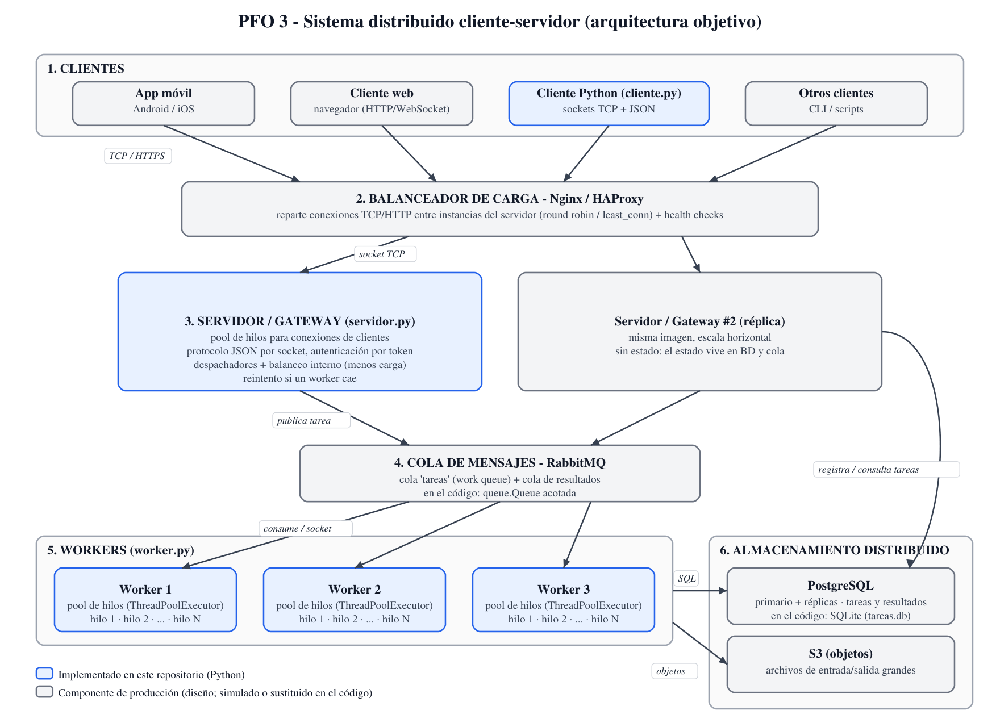

# PFO 3: Rediseño como Sistema Distribuido (Cliente-Servidor)

| | |
|---|---|
| **Alumno** | Gastón Zampar |
| **Materia** | Programación sobre Redes — 3° E |
| **Carrera** | Tecnicatura Superior en Desarrollo de Software |
| **Institución** | IFTS N° 29 |
| **Trabajo** | Práctica Formativa Obligatoria 3 (PFO 3) |

## Descripción

Rediseño de un sistema cliente-servidor como **sistema distribuido** basado en sockets TCP. Un servidor recibe tareas de varios clientes y las reparte entre un conjunto de **workers** independientes, cada uno con su propio **pool de hilos**. Si un worker cae, el servidor lo detecta y reintenta la tarea en otro, de modo que el cliente no nota la falla (transparencia de fallos).

El trabajo tiene dos partes:

1. **Diseño**: diagrama de la arquitectura objetivo (clientes, balanceador, workers, cola de mensajes y almacenamiento distribuido).
2. **Implementación en Python** (solo biblioteca estándar): servidor, workers y cliente.

## 1. Diagrama del sistema




| Componente del diseño | Rol | En el código |
|---|---|---|
| **Clientes** (móvil, web, consola) | Generan tareas | `cliente.py` (sockets TCP + JSON) |
| **Balanceador de carga** (Nginx/HAProxy) | Reparte conexiones entre instancias del servidor, con health checks | No implementado: es infraestructura. El servidor es *stateless*, así que se puede replicar detrás de Nginx (`stream`) o HAProxy (modo `tcp`) |
| **Servidor / gateway** | Recibe tareas, las encola y las distribuye | `servidor.py` |
| **Workers con pool de hilos** | Ejecutan las tareas | `worker.py` (`ThreadPoolExecutor`) |
| **Cola de mensajes** (RabbitMQ) | Desacopla servidor y workers, absorbe picos | `queue.Queue` acotada dentro de `servidor.py` |
| **Almacenamiento** (PostgreSQL) | Persistencia de tareas/resultados y de archivos | SQLite (`tareas.db`) en lugar de PostgreSQL |

El diagrama muestra la arquitectura **objetivo** (producción). Lo marcado en azul está implementado en este repositorio; lo punteado es un componente de producción que el código simula o reemplaza por uno más simple.

## 2. Implementación

```text
PFO3/
├── servidor.py        # Servidor: recibe tareas por socket y las distribuye a workers
├── worker.py          # Worker: servidor TCP con pool de hilos que ejecuta tareas
├── cliente.py         # Cliente de consola (comandos, demo concurrente y menú)
├── tareas.py          # Catálogo de tareas que ejecutan los workers
├── protocolo.py       # Formato de mensajes compartido (JSON por línea sobre TCP)
├── iniciar_todo.py    # Atajo: levanta workers + servidor en una terminal
├── requirements.txt   # Sin dependencias externas
├── tests/
│   └── test_sistema.py
└── docs/              # Diagrama (png, svg, mermaid)
```

### Flujo de una tarea

```text
cliente ──socket──▶ hilo de conexión ──▶ cola ──▶ despachador ──socket──▶ worker (pool de hilos)
   ▲                                                    │                        │
   └────────────────────── resultado ◀──────────────────┴──── resultado ◀───────┘
```

1. El cliente abre un socket TCP y envía un mensaje JSON (`{"accion": "enviar", "tipo": "fibonacci", "datos": 30}`).
2. Un hilo del pool del servidor lo atiende, registra la tarea en la base (`pendiente`) y la pone en la cola.
3. Un despachador toma la tarea, elige el worker **con menos tareas en curso** (desempata por el menos recientemente usado) y se la envía por otro socket.
4. El worker la ejecuta en un hilo de su pool y devuelve el resultado.
5. El servidor guarda el resultado (`completada` o `error`) y responde al cliente.

### Protocolo

Un mensaje por línea, en JSON UTF-8, terminado en `\n` (TCP es un flujo de bytes y no delimita mensajes).

| Acción (cliente → servidor) | Campos | Respuesta |
|---|---|---|
| `enviar` | `tipo`, `datos`, `token` (si el servidor lo exige) | `{"ok": true, "id", "resultado", "worker", "ms"}` o `{"ok": false, "error"}` |
| `consultar` | `id` | datos de la tarea guardada |
| `estado` | — | tareas en cola y estado de cada worker |
| `tipos` | — | tipos de tarea disponibles |

Tipos de tarea: `fibonacci`, `factorial`, `es_primo`, `contar_primos`, `invertir`, `mayusculas`, `contar_palabras`, `sumar`, `hash_sha256`, `dormir`.

### Decisiones técnicas

- **Sockets TCP** (`socket`) con mensajes JSON delimitados por salto de línea.
- **Pool de hilos** en el servidor (conexiones de clientes) y en cada worker (ejecución de tareas), con `ThreadPoolExecutor`: se evita crear un hilo por conexión sin límite.
- **Cola acotada**: si se llena, el servidor responde "servidor saturado" en lugar de agotar la memoria (contrapresión).
- **Balanceo por menor carga** con contador de tareas en curso protegido por `threading.Lock`.
- **Tolerancia a fallos**: ante un error de conexión con un worker se lo marca caído unos segundos y la tarea se reintenta en otro; si no quedan workers se informa el error al cliente.
- **Timeouts**: se cierran las conexiones de clientes inactivos y se limita el tiempo de espera a los workers.
- **Autenticación** opcional por token compartido (`--token` o `PFO3_TOKEN`), comparado con `hmac.compare_digest`.
- **Validación** de cada entrada (rangos y tipos) y límite de tamaño de mensaje.
- **Logging** de conexiones, tareas y fallos con el módulo `logging`.
- **Persistencia** con consultas parametrizadas; una tabla `tareas` con estado, resultado, worker y tiempos.
- **Hilos y GIL**: los hilos de un mismo worker comparten un intérprete, por lo que las tareas de CPU no corren en paralelo real dentro de un worker. El paralelismo real viene de tener **varios workers (procesos distintos)**; para tareas de E/S los hilos sí alcanzan.

## Requisitos

- Python 3.10 o superior.
- No hace falta instalar paquetes.

## Ejecución

Forma rápida (una terminal, levanta 3 workers y el servidor):

```bash
python iniciar_todo.py
```

Forma manual (una terminal por proceso):

```bash
python worker.py --nombre worker-1 --puerto 6001
python worker.py --nombre worker-2 --puerto 6002
python worker.py --nombre worker-3 --puerto 6003
python servidor.py --puerto 5050 --workers 127.0.0.1:6001,127.0.0.1:6002,127.0.0.1:6003
```

Cliente (en otra terminal):

```bash
python cliente.py                         # menú interactivo
python cliente.py enviar fibonacci 30
python cliente.py enviar sumar "[1, 2, 3.5]"
python cliente.py enviar invertir "hola mundo"
python cliente.py consultar 1
python cliente.py estado
python cliente.py demo --tareas 12        # 12 tareas desde clientes concurrentes
```

Ejemplo real de salida:

```text
$ python cliente.py enviar fibonacci 30
[tarea 1] resultado: 832040
            worker: worker-1  tiempo: 0.06 ms

$ python cliente.py demo --tareas 12
...
12 tareas en 1.13 s. Reparto por worker: {'worker-1': 8, 'worker-3': 2, 'worker-2': 2}

$ python cliente.py estado
Tareas recibidas: 15  en cola: 0
  - 127.0.0.1:6001     activo  en curso: 0  completadas: 9
  - 127.0.0.1:6002     activo  en curso: 0  completadas: 3
  - 127.0.0.1:6003     activo  en curso: 0  completadas: 3
```

Tras detener el worker-2 (Ctrl+C en su terminal) y volver a ejecutar `demo`, las tareas siguen completándose en los otros dos workers y `estado` muestra el worker caído:

```text
6 tareas en 2.29 s. Reparto por worker: {'worker-3': 3, 'worker-1': 3}
  - 127.0.0.1:6002     CAÍDO   en curso: 0  completadas: 2
```

## Pruebas automatizadas

```bash
python -m unittest discover -s tests -v
```

Levantan workers y servidor reales en puertos libres de `localhost` y comprueban: resultados correctos, validación de datos, reparto entre workers, concurrencia real (12 tareas de 0,3 s terminan en menos de 2 s), caída de un worker y de todos, persistencia y consulta, token, JSON inválido, timeout por inactividad y saturación de la cola. Duran unos 25 segundos.

## Limitaciones y mejoras para producción

- RabbitMQ, Nginx/HAProxy, PostgreSQL y S3 forman parte del **diseño**; en el código se simulan con `queue.Queue` y SQLite, y el balanceo entre workers lo hace el propio servidor.
- La cola en memoria se pierde si el servidor se cae; RabbitMQ con colas durables y confirmaciones lo resolvería.
- La comunicación no está cifrada; en producción iría sobre TLS.
- El registro de workers es una lista fija; podría haber auto-registro y *health checks* periódicos.
- Un solo servidor es un punto único de falla; se resuelve replicándolo detrás del balanceador.
