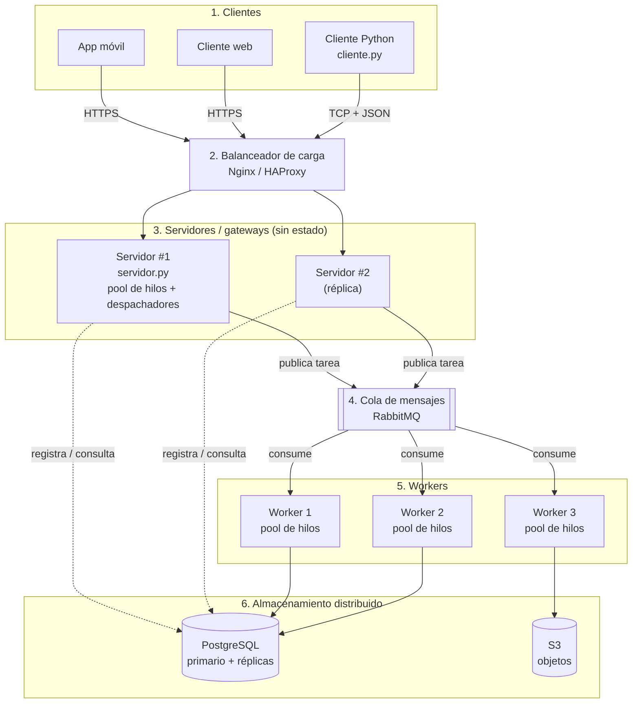

# Diagrama del sistema (Mermaid)

Se renderiza automáticamente en GitHub. Versión gráfica: [`diagrama.png`](diagrama.png) / [`diagrama.svg`](diagrama.svg).

Implementado en el repositorio: `cliente.py`, `servidor.py` (incluye la cola como `queue.Queue` y el balanceo hacia los workers), `worker.py` y SQLite en lugar de PostgreSQL. Balanceador, RabbitMQ, réplicas y S3 son componentes de producción del diseño.
